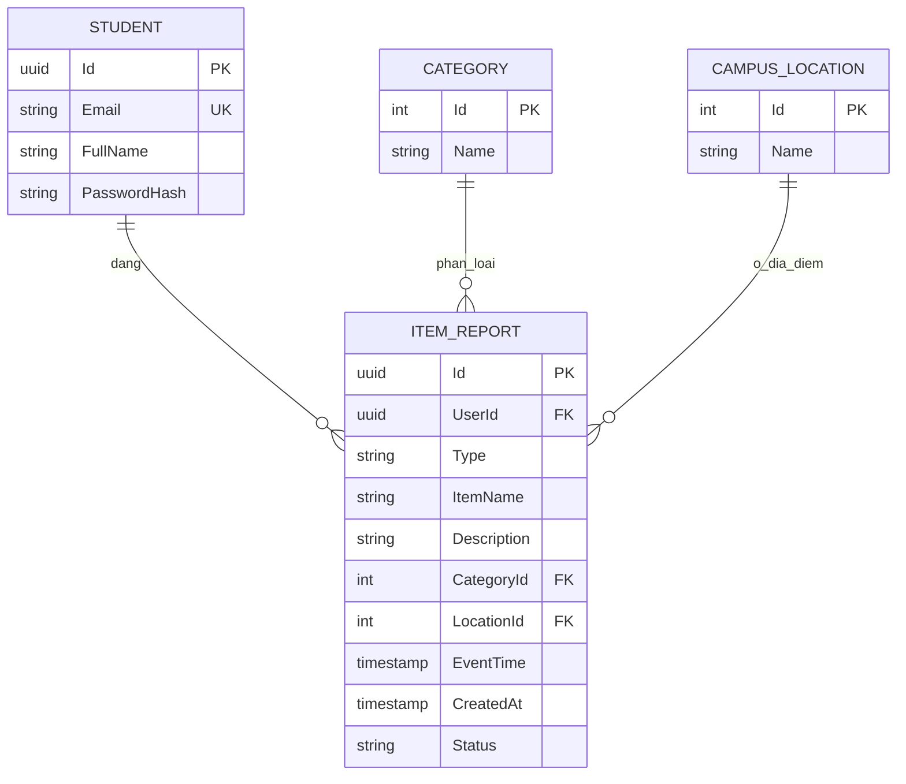

# Mô hình dữ liệu tối thiểu – Sprint 1

- Một sinh viên có thể có nhiều bài đăng.
- Một bài đăng thuộc **một** danh mục và **một** khu vực chuẩn.
- `Type`: `LOST` hoặc `FOUND`.
- `Status`: `OPEN` trong demo (có thể mở rộng khi triển khai quy trình xác minh/bàn giao ở Sprint sau).
- Có khóa ngoại, index phục vụ lọc và ngày đăng, mật khẩu được hash.
- Không đưa bảng `MATCH_RESULT`, `CLAIM_REQUEST`, `HANDOVER_ROOM` vào Sprint 1 vì ngoài phạm vi.

**Ghi chú:** `EnsureCreated` dùng cho database Sprint 1 chạy độc lập. Không dùng nó để nâng cấp schema của database Foundly Full Operations đang sử dụng thực tế; dự án lâu dài nên dùng EF Core migrations.
