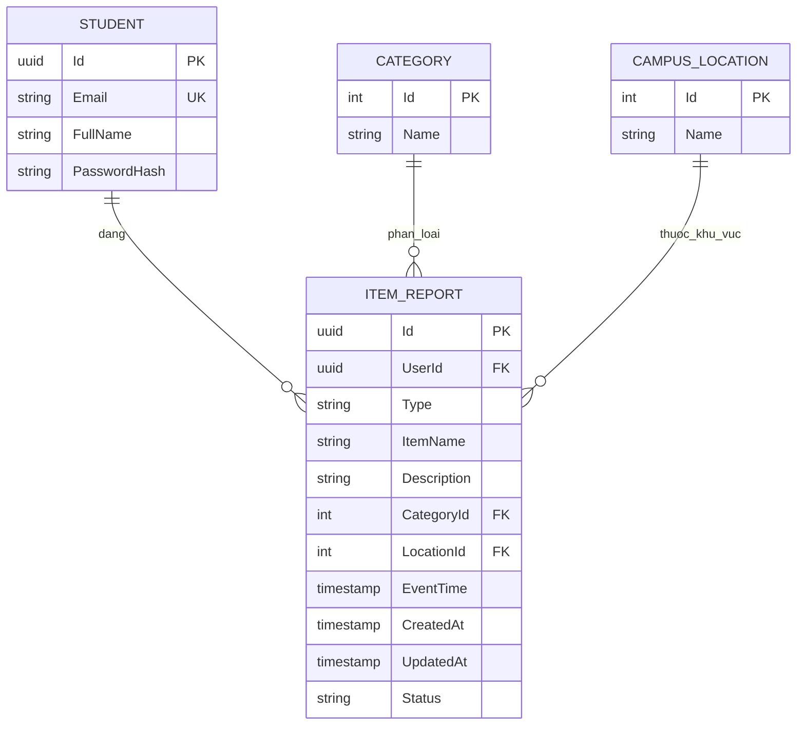

# THIẾT KẾ CƠ SỞ DỮ LIỆU – SPRINT 1

**Người phụ trách:** Phạm Việt Anh  
**Hệ quản trị:** PostgreSQL  
**Database:** `sprint1`  
**Trạng thái thiết kế:** Hoàn thành theo cập nhật nhóm

## 1. Mục tiêu

Lưu tập trung thông tin sinh viên, bài đăng mất/nhặt đồ, danh mục vật phẩm và khu vực trong trường. Cấu trúc phải hỗ trợ thêm bài, danh sách, tìm kiếm, bộ lọc và xem chi tiết trong Sprint 1.

## 2. Sơ đồ ERD



**Tên bảng thực tế khi EF Core tạo trong PostgreSQL:** `Students`, `Categories`, `Locations`, `Reports`. Tên trong ERD là tên logic để dễ trình bày.

## 3. Ý nghĩa các bảng

| Bảng thực tế | Vai trò | Thuộc tính chính |
|---|---|---|
| `Students` | Sinh viên đăng tin | `Id`, `Email`, `FullName`, `PasswordHash` |
| `Categories` | Danh mục vật phẩm | `Id`, `Name` |
| `Locations` | Khu vực trong trường | `Id`, `Name` |
| `Reports` | Bài LOST/FOUND | `Id`, `UserId`, `Type`, `ItemName`, `Description`, `CategoryId`, `LocationId`, `EventTime`, `Status`, `CreatedAt`, `UpdatedAt` |

## 4. Quan hệ và ràng buộc

- Một `Student` có thể đăng nhiều `Report`; mỗi `Report` thuộc một sinh viên.
- Một `Category` có nhiều `Report`; một bài thuộc một danh mục.
- Một `Location` có nhiều `Report`; một bài thuộc một khu vực.
- `Reports.UserId`, `CategoryId`, `LocationId` là khóa ngoại được cấu hình trong Entity Framework Core.
- `Students.Email` có chỉ mục **UNIQUE**.
- `Reports` có các chỉ mục hỗ trợ truy vấn theo trạng thái, ngày đăng, danh mục và khu vực.
- `Type` nhận `LOST` hoặc `FOUND` qua kiểm tra của API; `Status` dùng `OPEN` cho các bài đang hiển thị trong bản demo.
- Mật khẩu được lưu dưới dạng hash, không lưu mật khẩu gốc.

## 5. Luồng lưu và truy vấn dữ liệu

```text
React – US-01 Đăng tin
        ↓ POST /api/reports
ASP.NET Core – Validate và kiểm tra tài khoản
        ↓ EF Core SaveChangesAsync()
PostgreSQL – bảng Reports
        ↓ GET /api/reports
React – US-02 / US-03 / US-04 / US-05
```

Bộ lọc được áp dụng trong truy vấn PostgreSQL; ứng dụng không cần tải toàn bộ bài đăng về trình duyệt để lọc.

## 6. Kiểm tra dữ liệu thực tế

Mở Terminal tại `sprint-01-demo`:

```powershell
docker compose exec postgres psql -U sprint1 -d sprint1
```

Sau đó nhập:

```sql
\dt
SELECT "ItemName", "Type", "Status", "CreatedAt"
FROM "Reports"
ORDER BY "CreatedAt" DESC
LIMIT 10;
```

Khi tạo một bài mới từ giao diện và truy vấn lại, bảng `Reports` phải chứa bản ghi vừa tạo. Đây là cách nhóm kiểm chứng liên kết frontend – API – database.

## 7. Mã nguồn minh chứng

- [Định nghĩa thực thể – Entities.cs](../../sprint-01-demo/api/Domain/Entities.cs)
- [DbContext, khóa ngoại, chỉ mục – SprintDb.cs](../../sprint-01-demo/api/Data/SprintDb.cs)
- [Dữ liệu mẫu – SeedData.cs](../../sprint-01-demo/api/Data/SeedData.cs)
- [API đọc bài – ReportsReadController.cs](../../sprint-01-demo/api/Controllers/ReportsReadController.cs)
- [API ghi bài – ReportsWriteController.cs](../../sprint-01-demo/api/Controllers/ReportsWriteController.cs)

**Giới hạn Sprint 1:** Chưa thiết kế bảng cho Matching, Claim, Notification, Chat hoặc Handover. Bản demo dùng `EnsureCreatedAsync()` để khởi tạo database riêng; phiên bản dự án dài hạn nên dùng EF Core migrations để quản lý thay đổi lược đồ.
